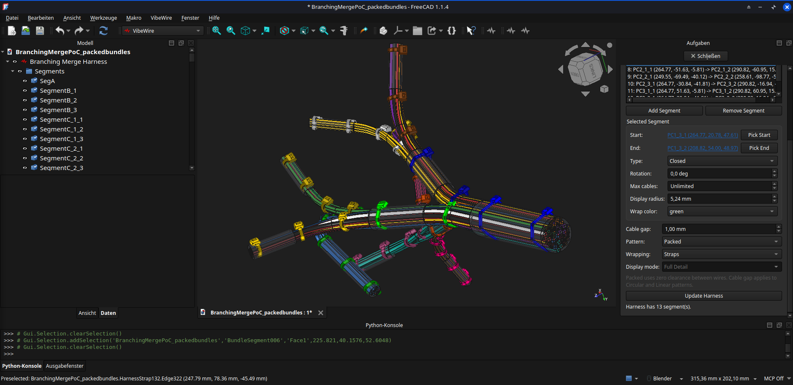
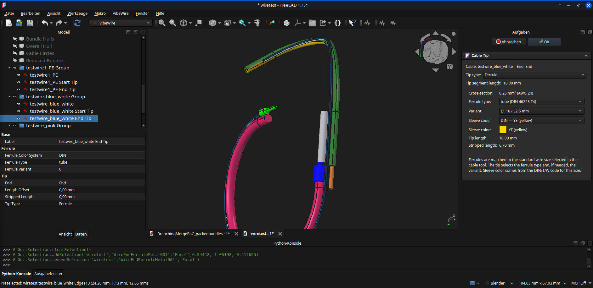
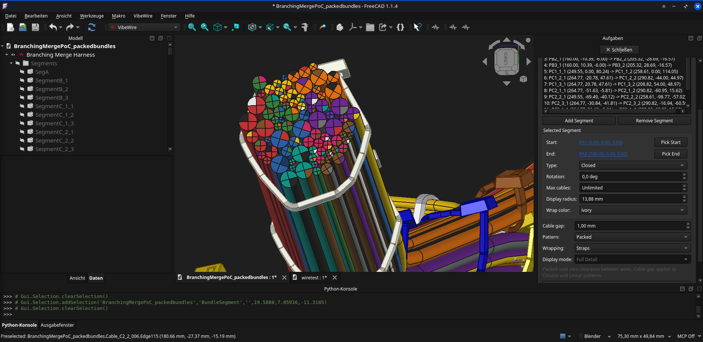

> **TL;DR:** A mostly vibe coded FreeCAD workbench for routing cables along reusable segments, insulation colors, and configurable cable tips. **Very much work in progress! Looking for feedback**

# VibeWire for FreeCAD

VibeWire is a FreeCAD workbench for modeling cable harnesses by routing wires along straight bundle segments. Cables are built from ordered segment runs with per-segment directions. Currently a playground for features. Expect breaking changes. It's a living concept of what I personally want a wiring-harness tool to look like. So one day it can be matured into a production grade tool. If you need something less experimental i recommend to check out the [Cables Workbench](https://wiki.freecad.org/Cables_Workbench)

## Concept

Bundle segments (or just segments) define the physical path framework. A cable is an ordered list of bundle segments, with each segment running either normal or reversed. A harness groups segments and calculates how member cables are arranged along them. Each cable end is configured independently with a tip for length offsets, stripped wire, or ferrules.

## Features

- "high level" routing using segment based approach, wires will follow automaitcally
- Per-harness settings such as arrangement type for cables in a segment ( linear, circular, packed, packed bundles)
- Per-cable/wire settings such as common wire sizes (or custom cable diameter), cable color (with tracer-color support), minimum bending radius ( auto-feature on the todo)
- Per-tip settings such as stripped wire, offset (for connectors on cables), and ferrules ( with automatic ferrule selection for the wire, including correct colors depending on your color-code choice)
- Calculates cable length and stores it in the cable object (for BOM / production exports)
- Contextual Task-panel with on-hover highlights of what you are about to edit
- Many settigs feature live-updates in the 3d view, not all tho.
- Physics-engine based cable-packing in a bundle (you read that right, it does take a moment tho). Giving you the circumfence of your bundle and the diameter of the smallest hole it will definetly fit through (unless your packing is worse than the simulation)
- Automatic strap generation (zip ties), with per segment color choice including neon colors (saved as strap property for BOM export), also width and required length and equivalent bundle diameter are saved for bom/procurement.
- Visually pleasing, and about 95% accurate. The approximation yields good result and is reasonably robust. Minor self-intersection exists but real wires should be able to handle it.

## History

Originally I only planned to tinker around with opencode (they allow you to waste some tokens on reasonably capable models) and freecad-mcp, curious how well it would solve something like connecting to line segments with bi-arcs without getting into the math myself. Turned out to be done in a blink. I threw 10 bucks at deepseek using the flash 1017 model and put a bunch of milestones down, blasting through them at breakneck speed. stuff got implemented as fast as i could come up with ideas for improvements. two days and 8 bucks into the token budget thinks look pretty good. lots of desirable features and a not so horrible workflow. Still plenty of things to do but it could already do a decent job on some projects. If you want to get a feeling for how things progressed, i let the ai write a diary.md. It's not a 1-line-per-promt but it hardly took more than 3 or 4 promts to get from one to the next. The plan.md still has a bunch of open  points for the future ( mostly exporting, naming, some ux improvements, etc). Lots will change, so don't use it for production yet.
